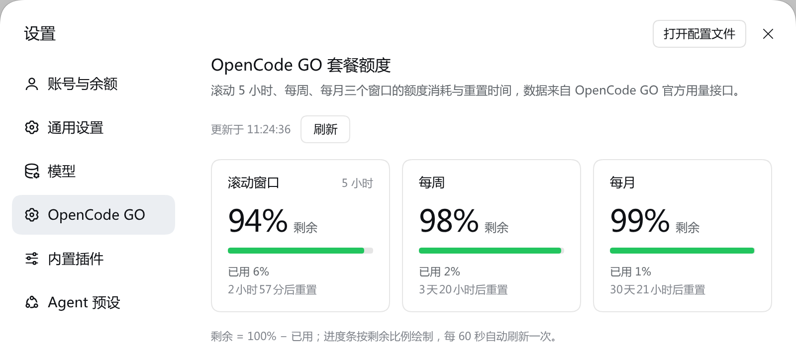

# dsh-opencode-go-quota

在 **设置 → OpenCode GO** 里查看 OpenCode GO 套餐额度，不占用左侧栏。这是
[`@astervolans/dsh-opencode-go-usage`](https://github.com/Astervolans/dsh-opencode-go-usage)
的改造分支（上游又是 [yumusb/dsh-opencode-go-usage](https://github.com/yumusb/dsh-opencode-go-usage) 的 fork）。

## 与上游的差异

| | 上游 1.5.0 | 本分支 |
|---|---|---|
| 入口 | 侧栏底部常驻 widget（`sidebar.footer.action`） | **设置页**（`settings.section`），与 Command Code / Codex 的账户页同级 |
| 展示 | 三条进度条 + 时间条，收起为百分比徽标 | 三张额度卡：剩余百分比、进度条、已用比例、重置倒计时与绝对时间 |
| 侧栏占用 | 有 | **无**，不注册任何侧栏槽位 |
| 更新检查 | 读 npm registry | 已移除（本包走 git 分发） |
| 路由 / 命令 | `/opencode-go/usage`、`/opencode-go` | `/dsh-opencode-go-quota/usage`、`/opencode-go-quota`（可与上游并存不撞） |
| 会话头修复 | 有（`x-opencode-session`） | 保留 |

数据来源不变：host 端用你的 key 调官方 `GET https://opencode.ai/zen/go/v1/usage`，浏览器只访问同源代理，key 不进前端。



## 安装

先移除旧插件（避免设置页出现两份 OpenCode GO）：

```bash
dsh plugin --profile web remove @astervolans/dsh-opencode-go-usage
dsh plugin --profile web add github:zztdandan/dsh-opencode-go-quota
```

配置凭据（默认变量名，可在插件配置里改 `apiKeyEnv`）：

```yaml
# ~/.dsh/.credentials.yaml
OPENCODE_GO_API_KEY: sk-...
```

重启 dsh web，硬刷新浏览器。入口：**设置 → OpenCode GO**；对话里也可用 `/opencode-go-quota`。

> 版本门禁：`peerDependencies` 为 `@deepseek-ai/dsh >=0.1.7-rc.1 <0.3.0`，覆盖 0.2.1-rc.2。

## 配置

| 键 | 默认 | 说明 |
|---|---|---|
| `apiKeyEnv` | `OPENCODE_GO_API_KEY` | 凭据引用 / 环境变量名 |
| `baseUrl` | `https://opencode.ai/zen/go` | GO 网关地址 |
| `cacheMs` | `30000` | host 端上游缓存 TTL |
| `injectSessionHeader` | `true` | 为 GO 网关聊天请求注入 `x-opencode-session` |

## 验证边界

- 已在 DSH `0.2.1-rc.2` 的隔离 profile 中实测（2026-10-29）：
  - 安装后启动正常，设置导航出现 **OpenCode GO** 项；
  - `GET /dsh-opencode-go-quota/usage` 返回真实三窗口数据（rolling/weekly/monthly 的 `percent` 与 `resetsAt`）；
  - Chromium 实测设置页渲染三张卡（94% / 98% / 99% 剩余，倒计时与进度条正确），中英文案均正常，无 console/page error；
  - 斜杠命令列表中出现 `opencode-go-quota`；
  - 左下角侧栏没有任何本插件入口（与上游 widget 的关键差异）。
- 未做：额度触顶/401/订阅过期等异常分支的真实账号验证（`percent` 阈值配色按代码逻辑推定）。

## 回滚

```bash
dsh plugin --profile web remove dsh-opencode-go-quota
```

## License

MIT。原版权归 opencode-go-usage contributors；fork 说明见 [NOTICE](./NOTICE)。
