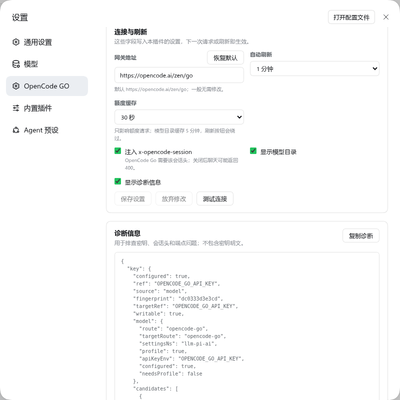

# dsh-opencode-go-quota-settings

在 **设置 → OpenCode GO** 里查看额度、模型目录和连接配置，并在同一个页面填写密钥；密钥与
DSH 自己的 `opencode-go` 模型路由**同源**，不需要重复配置。不占用左侧栏。这是
[`@astervolans/dsh-opencode-go-usage`](https://github.com/Astervolans/dsh-opencode-go-usage)
的改造分支（上游又是 [yumusb/dsh-opencode-go-usage](https://github.com/yumusb/dsh-opencode-go-usage) 的 fork）。

## 与上游的差异

| | 上游 1.5.0 | 本分支 |
|---|---|---|
| 入口 | 侧栏底部常驻 widget（`sidebar.footer.action`） | **设置页**（`settings.section`），与 Command Code / Codex 的账户页同级 |
| 展示 | 三条进度条 + 时间条，收起为百分比徽标 | 三张额度卡：剩余百分比、进度条、已用比例、重置倒计时、绝对时间与窗口占比 |
| 密钥来源 | 只能另配 `OPENCODE_GO_API_KEY` | **复用 DSH 模型路由的同一把 key**：`providers.opencode-go.apiKeyEnv` → `llm-pi-ai/opencode-go` 登录凭据 → `OPENCODE_API_KEY` → 兜底 `OPENCODE_GO_API_KEY` |
| 密钥配置 | 只能改 `~/.dsh/.credentials.yaml` | 设置页内直接填写；写入模型路由使用的同一凭据引用，必要时同时补上 `providers.opencode-go.apiKeyEnv`，与模型页保存等效 |
| 额外读取 | 只有额度 | **模型目录**（`/v1/models`：上下文、输出上限、视觉/工具/推理能力、每 1M token 价格、峰时倍率）；**密钥指纹**（不暴露明文）；**诊断快照** |
| 页内配置 | 无 | **连接与刷新**卡片：网关地址、自动刷新间隔、额度缓存 TTL、`x-opencode-session`、显示模型目录/诊断；写入本插件设置，热生效 |
| 侧栏占用 | 有 | **无**，不注册任何侧栏槽位 |
| 更新检查 | 读 npm registry | 已移除（本包走 git 分发） |
| 路由 / 命令 | `/opencode-go/usage`、`/opencode-go` | `/dsh-opencode-go-quota-settings/usage`、`/dsh-opencode-go-quota-settings/models`、`/opencode-go-quota`（可与上游并存不撞） |
| 会话头修复 | 有（`x-opencode-session`） | 保留，并可在页面里开启/关闭 |

数据来源是官方 OpenCode Go 接口：`GET https://opencode.ai/zen/go/v1/usage` 和
`GET https://opencode.ai/zen/go/v1/models`。host 端用你的 key 调用，浏览器只访问同源代理，key 不进前端。


## 安装

先移除旧插件（避免设置页出现两份 OpenCode GO）：

```bash
dsh plugin --profile web remove @astervolans/dsh-opencode-go-usage
dsh plugin --profile web add dsh-opencode-go-quota-settings
```

（未使用 npm 时也可从源码安装：`dsh plugin --profile web add github:zztdandan/dsh-opencode-go-quota-settings`。）

重启 dsh web，硬刷新浏览器。入口：**设置 → OpenCode GO**；对话里也可用 `/opencode-go-quota`。

## 密钥：与模型设置同源

插件不再要求你为额度单独复制一遍 key。它按 DSH 自己的 `opencode-go` 路由解析顺序读取：

1. `llm-pi-ai` 的 `providers.opencode-go.apiKeyEnv`（没有 `opencode-go` 时也会参考 `providers.opencode`）；
2. `llm-pi-ai` 登录流程写入的凭据记录 `llm-pi-ai/opencode-go`；
3. pi-ai 的原生环境引用 `OPENCODE_API_KEY`；
4. 最后才是本插件的兜底配置 `apiKeyEnv`（默认 `OPENCODE_GO_API_KEY`）。

所以只要 **设置 → 模型 → OpenCode Go** 里能聊天，这里就能读额度；已配置时页面会显示正在使用的引用和来源，不会索要第二把 key。

也可以直接在 **设置 → OpenCode GO** 的 **API 密钥** 卡片里粘贴 key 保存：

- 优先写入模型路由命名的引用（如 `OPENCODE_API_KEY`、自定义 `apiKeyEnv`）；模型使用登录凭据时写入兜底引用（默认 `OPENCODE_GO_API_KEY`）并把它绑定到模型路由，使用原生环境时写回 `OPENCODE_API_KEY`；
- 如果模型路由还没有命名引用，页面会像模型页一样补上 `providers.opencode-go.apiKeyEnv`，把 key 绑定到 OpenCode Go；
- 如果模型页里还没有 OpenCode Go，第一次保存会把该 provider 和 key 一起创建；
- 已经配好 key（例如旧版本留下的 `OPENCODE_GO_API_KEY`，或 DSH 登录凭据）但模型页还没绑定？页面会显示 **同步到模型设置**，点一下即可，不需要重新粘贴 key；
- 保存后立即绕过额度缓存并刷新，模型和额度都使用这把新 key。

> 仍可用文件方式配置（与模型页写入的是同一个凭据域）：
>
> ```yaml
> # ~/.dsh/.credentials.yaml
> OPENCODE_API_KEY: sk-...
> ```

## 模型目录（读取）

额度卡下方的 **模型目录** 来自官方 `GET /v1/models`，不是本地硬编码：

- 每个模型显示 id、上下文/输出上限、视觉/工具/推理能力、推理档位、每 1M token 的输入/输出/缓存读价格、峰时倍率和协议；
- 搜索框按名称、ID、家族或 canonical id 过滤；
- DSH 的默认模型（`agent-default-model`）会高亮并排在最前；
- “刷新模型”强制重新读取；host 端缓存 5 分钟，密钥或端点变化时自动失效；
- “测试连接”会强制请求一次 `/v1/models`，显示模型数量与往返延迟。

## 连接与刷新（页内配置）



页面底部的 **连接与刷新** 卡片直接编辑本插件的设置，和 **设置 → 插件** 里的配置表单是同一份，写入后热生效：

| 控件 | 对应字段 | 说明 |
|---|---|---|
| 网关地址 | `baseUrl` | 默认 `https://opencode.ai/zen/go` |
| 自动刷新 | `refreshMs` | 30 秒 / 1 分钟 / 2 分钟 / 5 分钟 |
| 额度缓存 | `cacheMs` | 0 / 15 / 30 / 60 / 300 秒；只影响额度请求，页面上手动刷新会绕过 |
| 注入 `x-opencode-session` | `injectSessionHeader` | 可运行时开关；关闭后聊天可能被网关拒绝 |
| 显示模型目录 | `showModels` | 关闭后只保留额度、密钥和连接卡片 |
| 显示诊断信息 | `showDiagnostics` | 打开后出现诊断卡片 |

## 诊断

开启 **显示诊断信息** 后，页面会显示：

- 密钥引用、来源、指纹、候选引用列表；
- 模型路由的 `apiKeyEnv`、profile 是否存在、是否已可服务；
- `x-opencode-session` 的注入次数、最近一次 `llm/stream` 的 provider / base / session 是否存在；
- 模型目录的读取时间与延迟。

“复制诊断”输出的是同一份 JSON，**不包含密钥明文**，可直接贴到 issue 里。

> 版本门禁：`peerDependencies` 为 `@deepseek-ai/dsh >=0.1.7-rc.1 <0.3.0`，覆盖 0.2.1-rc.2。

## 配置

| 键 | 默认 | 说明 |
|---|---|---|
| `apiKeyEnv` | `OPENCODE_GO_API_KEY` | **兜底**凭据引用；仅当模型路由没有 `apiKeyEnv`、没有登录凭据、也没有 `OPENCODE_API_KEY` 时使用 |
| `baseUrl` | `https://opencode.ai/zen/go` | GO 网关地址；额度、模型目录和会话头共用 |
| `cacheMs` | `30000` | host 端额度缓存 TTL；设置页保存密钥或点“刷新”会绕过 |
| `refreshMs` | `60000` | 设置页自动刷新间隔（最小 15 秒） |
| `injectSessionHeader` | `true` | 为 GO 网关聊天请求注入 `x-opencode-session`；可热开关 |
| `showModels` | `true` | 设置页是否显示模型目录卡片 |
| `showDiagnostics` | `false` | 设置页是否显示诊断卡片 |

## 发布（自动化）

发布由 GitHub Actions 完成，规则是**版本号变了才发**：

```bash
npm version patch --no-git-tag-version
VERSION=$(node -p "require('./package.json').version")
git commit -am "chore: release v$VERSION"
git push origin master
```

`Release` 工作流会检查 npm 上是否已有该版本：没有则 `npm publish --provenance`、打 `v<version>` tag、创建 GitHub Release；已有则跳过（幂等）。细节与各市场的跟随方式见 [docs/releasing.md](docs/releasing.md)。

## 验证边界

- 已在 DSH `0.2.1-rc.2` 的隔离 profile 中用真实 OpenCode Go key 实测（2026-10-31，只调用只读的 `/v1/usage`、`/v1/models`，不产生推理用量）：
  - 安装后启动正常，设置导航出现 **OpenCode GO** 项；
  - `GET /dsh-opencode-go-quota-settings/usage` 返回真实三窗口数据（rolling/weekly/monthly 的 `percent`、`status` 与 `resetsAt`）；
  - `/models` 返回 28 个真实 Go 模型，上下文、输出上限、能力、价格和峰时倍率解析正确；
  - Chromium 实测设置页渲染密钥卡 + 三张额度卡 + 模型目录 + 连接卡片，中英文案均正常，无 console/page error；
  - 密钥同源的四条路径逐一验证：模型 `apiKeyEnv`、`llm-pi-ai/opencode-go` 登录凭据、原生 `OPENCODE_API_KEY`、兜底 `OPENCODE_GO_API_KEY`；前三条都无需再次配置；
  - 设置页保存密钥后，凭据写入模型使用的同一引用，额度请求立即改用新 key；
  - 模型页还没有 OpenCode Go 时，设置页首次保存会创建 `providers.opencode-go.apiKeyEnv`；保存后 **设置 → 模型** 出现 opencode-go 条目，与模型页保存效果一致；
  - 已存在 key 但模型路由未绑定时，**同步到模型设置** 按钮只补配置、不重写凭据，点击后模型状态立即变为已就绪；
  - 页内保存 `refreshMs`、`cacheMs`、`showModels`、`showDiagnostics` 会写入 profile 并即时生效；关闭/开启模型目录卡片、显示/隐藏诊断卡片均实测；
  - “测试连接”返回 `连接正常 · 28 个模型 · 326 ms`；“复制诊断”得到的 JSON 不含 key 明文，只含引用、来源和指纹；
  - 斜杠命令列表中出现 `opencode-go-quota`；
  - 左下角侧栏没有任何本插件入口（与上游 widget 的关键差异）。
- 密钥路径和缓存/刷新行为另用本地假网关记录 `Authorization` 验证；未做真实账号的额度触顶/401/订阅过期分支（`percent` 阈值配色按代码逻辑推定）。

## 回滚

```bash
dsh plugin --profile web remove dsh-opencode-go-quota-settings
```

## License

MIT。原版权归 opencode-go-usage contributors；fork 说明见 [NOTICE](./NOTICE)。
